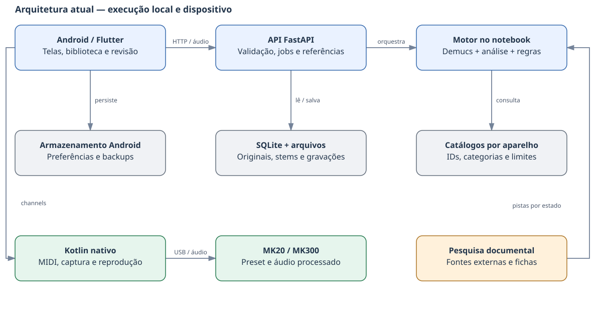
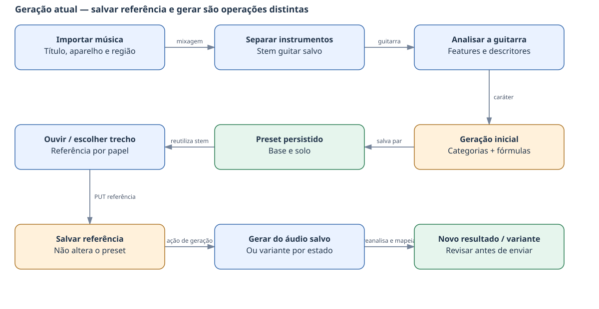
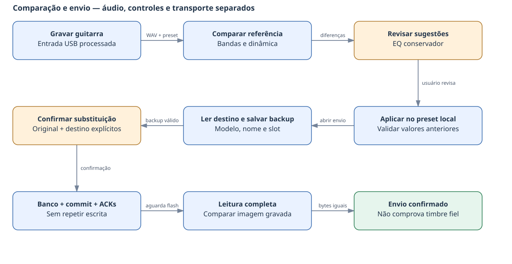

# AI Tone Studio — documentação técnica e lógica

**Documento de revisão • versão 1.0 • 08/11/2026**  
**Produto documentado:** Android 1.6.1+25 / API 1.6.1  
**Base de código:** `develop`, commit `b5f036568a965cfe791ff2272480ea98352efe88`  
**Escopo:** comportamento implementado, limitações e proposta de evolução para avaliação. Nenhuma mudança funcional foi realizada para produzir este documento.

## 1. Leitura executiva

O objetivo do app é receber uma música, extrair uma referência de guitarra e gerar presets que possam ser enviados às pedaleiras M-VAVE MK20 e MK300. A gravação da guitarra do usuário permite comparar o resultado e revisar ajustes pelo próprio app.

Hoje a separação usa uma rede neural real, Demucs. A escolha de equipamento e a tradução para os controles são predominantemente heurísticas: regras programadas sobre características do áudio e categorias do catálogo. Não há modelo treinado que reproduza a resposta sonora de cada amplificador, drive ou gabinete dessas pedaleiras. Também não há execução de áudio por um simulador de todos os candidatos para comparar seu som com a referência.

Há dois caminhos de geração: **inicial por música/trecho** e **variante por estado de timbre**. Eles não usam exatamente as mesmas regras. A variante já considera compatibilidade de categoria e pistas documentais; isso ainda não representa uma classificação acústica dos modelos.

**Principal lacuna percebida em Infest:** salvar um trecho para referência/comparação não regenera o preset existente. Além disso, os dois caminhos mantêm o bloco de drive desligado. Um AMP pode produzir distorção sem DS, mas o código atual não demonstra que o modelo escolhido e seu ganho reproduzam a distorção desejada.

### 1.1 Situação por capacidade

| Capacidade | Estado atual | Limite relevante |
|---|---|---|
| Importar música e preservar nome | Implementado | Arquivo e nome de envio ao pedal são conceitos distintos |
| Separar instrumentos | Demucs `htdemucs_6s` | Guitarras base/solo sobrepostas podem permanecer juntas |
| Identificar mudanças de timbre | Agrupamento de janelas por canal | Rótulos prováveis; não reconhece o músico |
| Gerar preset por trecho | Implementado por regras | Não otimiza a resposta sonora real do aparelho |
| Pesquisa de artista/música | Implementada no caminho de estados | Fontes e pistas não comprovam o equipamento da gravação |
| Comparar guitarra gravada | Comparação espectral conservadora | Não mede fidelidade nem corrige automaticamente a saturação |
| Transferir para MK20/MK300 | Implementado com backup e leitura | Sucesso de transporte não garante qualidade sonora |
| Aprender com avaliações | Avaliações são armazenadas | Não há treinamento ou aprendizado automático a partir delas |
| Catálogo sonoro aprofundado | Proposto | Não está integrado à geração atual |

## 2. Arquitetura e responsabilidades

| Camada | Tecnologia / localização | Responsabilidade |
|---|---|---|
| Interface Android | Flutter/Dart, `android/lib/screens` | Importar, acompanhar análise, editar, ouvir referência, comparar e confirmar envio |
| Estado local | Provider + SharedPreferences | Biblioteca de pares, ajustes e referências locais; não é o banco SQLite do servidor |
| Integração nativa | Kotlin, `android/android/app/src/main/kotlin/com/aitone/studio` | USB MIDI, BLE, captura de áudio e reprodução |
| API | Python/FastAPI, `backend/app/api` | Validação HTTP, tarefas, referências, gravações e diagnósticos |
| Orquestração | `backend/app/core/pipeline.py` | Coordenar análise, compilação, refinamento e alternativas |
| Motor de áudio | `backend/app/services/tone_engine` | Preparar áudio, separar, medir, classificar e mapear parâmetros |
| Catálogos | `catalogs/` e `android/assets/` | IDs, nomes, categorias, limites e escalas por equipamento |
| Persistência | SQLite + arquivos em `backend/data` | Resultados, instrumentos separados, originais e gravações |

O celular envia áudio ao notebook/servidor pela rede. O servidor não controla diretamente a USB da pedaleira conectada ao celular. O envio físico é realizado localmente pelo Android. A pesquisa documental pode acessar a internet; a inferência de separação usa o ambiente Demucs local.

### 2.1 Dependências e execução

Backend declarado em `backend/requirements.txt`: FastAPI, Uvicorn, Pydantic, NumPy, librosa, SoundFile, SciPy, scikit-learn e bibliotecas de testes. FFmpeg é executado como programa externo. Demucs fica em ambiente separado, por padrão `repertorio/laboratorio/.venv/bin/python`; a API não importa Torch no seu processo para fazer a separação.

Flutter declara HTTP, seleção de arquivos, Provider, preferências, permissões, arquivos locais e compartilhamento em `android/pubspec.yaml`. Kotlin utiliza APIs nativas do Android para o hardware.

O serviço `ops/ai-tone-studio.service.in` executa Uvicorn em `0.0.0.0:8000`, com reinício após falha. É um serviço do usuário: estar habilitado no login não comprova inicialização sem login. A URL é configurada no app; o valor padrão ainda está fixado no código e não há descoberta automática do servidor.

## 3. Fluxo de uma geração inicial

1. O usuário importa o arquivo e informa artista, título, dispositivos de base/solo e, opcionalmente, os trechos.
2. `ApiService.submitAnalysis` envia `POST /api/v1/analyze` com `engine_mode=guitar_v2` e `analyze_states=true`.
3. A API valida formato, tamanho, dispositivos e intervalos. O limite padrão de upload musical é 50 MiB, configurável por `MAX_UPLOAD_MB`. Sem trecho, pode analisar a música completa.
4. A API cria um `job_id`, registra o estado e inicia o processamento em `BackgroundTasks`.
5. O original é preservado por SHA-256 em `generation_inputs`. O pipeline trabalha em diretório temporário e executa a parte intensiva em thread.
6. O pré-processador usa FFmpeg para WAV estéreo, 44,1 kHz, float32. Não normaliza o volume antes de medir a referência.
7. Para uma mixagem, Demucs separa os instrumentos. Uma entrada declarada isolada pode seguir sem separação.
8. O extrator mede a guitarra; o motor define descritores e categoria de ganho.
9. O compilador escolhe modelos do catálogo e o refinamento aplica regras aos parâmetros.
10. O resultado inclui base, solo, diagnósticos e candidatos. Sem trecho de solo distinto, a análise de referência é compartilhada entre os papéis. Isso não reconhece automaticamente que uma passagem pertence à base ou ao solo.
11. O servidor salva o par; opcionalmente detecta estados e pesquisa fontes. Falha nessa etapa adicional é registrada sem necessariamente descartar o par já gerado.
12. O app consulta o job a cada dois segundos, carrega o resultado e salva uma cópia na biblioteca local.

**Compatibilidade importante:** o endpoint ainda tem `legacy` como valor padrão se um cliente não enviar `engine_mode`. O app atual envia explicitamente `guitar_v2`. O motor legado permanece no repositório; não deve ser confundido com o fluxo atual do Android.

### 3.1 Separação e cache

O worker utiliza `htdemucs_6s`, CPU, `shifts=0`, segmento de quatro segundos e sobreposição 0,25. Produz `drums`, `bass`, `other`, `vocals`, `piano` e `guitar`. A normalização interna exigida pelo modelo é revertida na saída. Os WAVs são float32.

A identidade do cache inclui hash do áudio preparado, provedor, modelo e configuração. O manifest guarda hashes dos stems; arquivos incompletos não são publicados como cache válido. Um lock limita a separação concorrente no processo da API. Isso não é uma fila distribuída entre múltiplos servidores.

**Separar guitar não equivale a obter duas faixas independentes de base e solo.** L/R podem ajudar a escolher uma referência, mas largura estéreo não prova que há dois guitarristas isolados.

### 3.2 Progresso

O worker emite eventos JSON de carregamento, blocos concluídos e salvamento. O bloco é contado depois de obter e misturar seu resultado. A API recebe esses eventos durante a execução e persiste atualizações com limitação de frequência. A interface consulta o job e apresenta a contagem real da separação.

O percentual geral é ponderado por etapas, não uma previsão exata de tempo restante. Carregar modelo, calcular features e salvar arquivos não têm todos a mesma granularidade. O tempo exibido é o tempo decorrido na tela. Somente uma tarefa concluída recebe 100% geral.

As tarefas usam memória e registros SQLite; não existe executor durável que retome o cálculo após reinício. Um job interrompido é reportado como falha quando recuperado. O timeout do worker é de uma hora e sua falha não gera preset silenciosamente usando a mixagem.

## 4. Como o áudio vira configurações hoje

### 4.1 Medidas e descritores

`features.py` trabalha com canal selecionado ou o canal de maior energia, reamostragem para 32 kHz e análise espectral. Mede RMS, pico, clipping, crest factor, faixas de energia, centroide, rolloff, flatness, cruzamentos por zero, MFCC, ataque e indicadores de densidade harmônica e largura estéreo.

O indicador de distorção combina cruzamentos por zero, entropia espectral, um proxy de compressão e flatness. É um valor de regra, não uma probabilidade nem uma medição da posição do Gain do equipamento original. O `descriptor.py` converte parte das medidas para valores de referência independentes do aparelho.

| Classificação da geração inicial | Regra sobre o indicador |
|---|---|
| Clean | abaixo de 0,25 |
| Crunch | de 0,25 até antes de 0,43 |
| Overdrive | de 0,43 até antes de 0,55 |
| High gain | a partir de 0,55 |

A detecção de estados usa outros limiares: abaixo de 0,35 é clean; abaixo de 0,55 é crunch; a partir de 0,55 é distorted. São classificadores diferentes. As confianças do motor v2 são baixas por construção; não representam porcentagem de semelhança.

### 4.2 Escolha inicial dos modelos

`CatalogLoader.get_amp_model` busca a primeira correspondência de categoria preferida e tem fallback para o primeiro modelo. Gabinetes são escolhidos por preferências de tamanho/nome, com fallback. Isso valida disponibilidade no catálogo, não demonstra que um modelo soe mais próximo da música do que outro.

`PresetCandidateGenerator` pode criar até cinco alternativas distribuídas pela família do catálogo. Elas não são ordenadas por comparação acústica: a ordem não é um ranking de fidelidade.

### 4.3 Fórmulas do refinamento inicial

| Controle/bloco | Regra atual em `GuitarToneEngine.refine` |
|---|---|
| AMP Gain | `round(8 + distortion × 65)` |
| AMP Level | 40 |
| AMP Bass | `round(35 + bass × 25)` |
| AMP Middle | `round(35 + mids × 30)` |
| AMP Treble | `round(35 + treble × 30)` |
| AMP Pres | `round(30 + high_mids × 30)` |
| AMP Reso / Bright | 25 / 30 |
| DS | Desligado; valores iniciais Gain 10, Level 50 |
| CAB Level | 60; demais parâmetros seguem dados/defaults do catálogo |
| Delay, reverb, chorus e compressor | Presença forçada a falso no motor v2 por ausência de inferência confiável |

Os valores passam pelos limites e passos dos modelos. A validação evita um controle inválido ou um ID incompatível, mas não transforma uma fórmula genérica em calibração sonora.

**Consequência:** um trecho muito distorcido pode gerar um AMP com Gain moderado e DS desligado. Esses números não foram ajustados por uma curva medida daquele AMP na MK20 ou MK300.

### 4.4 Variante por estado: caminho diferente

`ToneStateAnalyzer` percorre canais com janelas de até seis segundos a cada três segundos, ignora sinal insuficiente e agrupa descritores com KMeans. Seleciona uma passagem real representativa, não um áudio médio artificial. O usuário pode indicar base/solo e revisar o caráter proposto.

`POST /presets/{pair_id}/tone-states/{state_id}/generate` reanalisa o trecho e cria uma variante. A identidade inclui origem, estado, papel, aparelho, pesquisa e, quando aplicável, região selecionada. Repetir a mesma solicitação pode reutilizar o resultado.

`evidence_mapping.py` pontua AMP por categoria e acrescenta pistas documentais de família; para CAB há preferência adicional por 4x12 em estados não limpos. O desempate é pelo ID textual. Essa pontuação **não usa a resposta acústica medida dos modelos**.

Depois do refinamento comum, a variante fixa Gain em **15 / 38 / 65** para clean / crunch / distorted e mantém DS desligado. Registra alternativas e justificativas nos metadados. A outra parte do par é copiada da origem: gerar base não significa gerar também um solo novo.

## 5. Referência escolhida, escuta e regeneração

Há três operações diferentes:

| Operação | Resultado | Altera os controles existentes? |
|---|---|---|
| Ouvir uma prévia | WAV temporário do intervalo/canal, com ganho apenas de escuta | Não |
| Salvar referência por papel | Registra região, canal, cache e perfil para comparação/reuso | Não |
| Gerar novamente ou criar variante | Executa análise/mapeamento e produz outro resultado | Sim, no resultado gerado |

`PUT /presets/{pair_id}/reference/{role}` salva a referência. `POST /analyze-saved` reaproveita os stems e gera outro par a partir das regiões de base/solo. A geração por estado tem seu próprio endpoint. O endpoint antigo `/regenerate/{role}` existe, mas retorna **501**; não é o caminho funcional de regeneração por trecho.

O preview permite 3–30 segundos. O ganho aplicado à escuta não altera o stem bruto nem a medição usada para decidir se o trecho é aproveitável. As regiões salvas e as solicitadas para geração reaproveitada aceitam 3–120 segundos.

### 5.1 Qualidade da referência

O critério `weak_relative_signal` sinaliza trechos abaixo de -40 dBFS e mais de 18 dB abaixo de uma referência forte do mesmo canal. A avaliação de estados compara os estados; a avaliação de um recorte consulta blocos do mesmo stem. São proteções contra sinal pouco útil, não prova de vazamento do separador.

Reclassificar uma passagem como distorcida não deve contornar a proteção de qualidade. Uma master uniformemente baixa não é descartada somente pelo volume absoluto. Referências e caches são verificados por hash.

## 6. Pesquisa documental implementada

`SongResearch` em `services/song_research/research.py` combina fichas locais e busca pública. Há uma lista permitida de domínios, validação de URL/endereço público, limites de download e tratamento de falhas. O conteúdo externo é dado, não instrução executada pelo app.

As fichas atuais de `sources.json` tratam de Everlong/Foo Fighters. Distinguem entrevista sobre a gravação de material de equipamento ao vivo. O serviço pode descobrir outras fontes e extrair menções de famílias por padrões de texto.

Pistas revisadas têm pesos diferentes conforme o contexto; a implementação também admite pistas automáticas muito fracas quando dois domínios permitidos mencionam a família e a música. Não equivale a confirmar o rig original. Revisão, origem e escopo são preservados. Disponibilidade de busca e páginas externas não é garantida.

Esta pesquisa influencia a **geração por estados**. A geração inicial do pipeline não faz a mesma seleção contextual antes de produzir o preset principal. A pesquisa realizada na conversa também não é automaticamente incorporada ao catálogo ou às fichas do app.

## 7. Captura USB e comparação

A ponte `ToneRecordingBridge.kt` lista entradas e utiliza `AudioRecord`, tenta selecionar o dispositivo pedido e captura WAV PCM16. A entrada USB depende de o Android reconhecer a pedaleira como dispositivo de áudio. USB MIDI e USB áudio têm funções distintas. O app não consegue concluir, apenas pelo nome da entrada, se o pedal está enviando som processado ou DI seco.

A comparação recebe gravação de 3–30 segundos, até 10 MiB, com snapshot do preset. O áudio é arquivado antes da comparação; um erro de análise pode retornar o identificador da gravação preservada.

A referência pode vir do arquivo explicitamente enviado, do trecho de guitarra salvo ou, como compatibilidade, de um perfil anterior. O resultado informa a origem. Comparar um perfil geral não equivale a comparar a mesma passagem musical.

### 7.1 O que a comparação decide

`relative-band-power-v1` compara energia relativa em graves (80–250 Hz), médios (250–2500 Hz) e agudos (2500–8000 Hz). Diferenças menores que 3 dB não geram correção daquela banda. Acima disso, sugere passo conservador em Bass/Middle/Treble do AMP, respeitando catálogo e limites.

Ajuste típico: aproximadamente 3% da faixa do controle, com mínimo de um passo. Diferença de crest factor a partir de 4 dB é uma observação de dinâmica. O algoritmo não estima uma curva acústica inversa e não busca automaticamente outro AMP ou CAB.

| Condição | Comportamento atual |
|---|---|
| RMS abaixo de 0,001 no fingerprint | Erro de gravação muito baixa/silenciosa |
| Clipping em pelo menos 0,5% das amostras medidas | Resultado de qualidade saturada, sem sugestões |
| Diferença de EQ suficiente | Sugestões conservadoras de Bass/Middle/Treble |
| Nenhuma diferença suficiente | Sem ajustes; isso não comprova timbre idêntico |
| Gain/drive/delay/reverb | Não corrigidos de forma confiável por este comparador |

A tela de resultado permite revisar sugestões, aplicá-las ao preset local e seguir ao envio. `applyToneAdjustments` verifica modelo, bloco e valor anterior para rejeitar sugestões obsoletas. Aplicar mudanças não dispara automaticamente uma nova gravação nem confirma melhora acústica.

### 7.2 Avaliações e calibração

As avaliações registram guitarra/captadores, rota, sinal processado/DI, avaliação humana e contexto do preset/referência. São registros versionados/idempotentes, não aprendizado automático.

Existe referência especial de Infest reconstruída de uma leitura aprovada do slot 76 da MK20, com ID e SHA da imagem verificados. Serve para captura de calibração da Konig; não substitui geração por música nem é copiada indiscriminadamente para novas faixas. Não constitui calibração de todos os modelos do aparelho.

## 8. Modelo de dados e persistência

| Entidade/conceito | Conteúdo / relação |
|---|---|
| Job | ID, estado, progresso, erro e ID do par quando concluído |
| Par | Preset de base e preset de solo; ID público ligado ao preset de base |
| Preset | ID, aparelho, papel, catálogo, nome, música, cadeia, volume, metadados e limitações |
| Bloco | Posição na cadeia, tipo, ID/nome do modelo, ligado/desligado e parâmetros |
| Parâmetro | Nome, valor, exibição, unidade, mínimo/máximo e passo quando disponíveis |
| Referência | Par/papel → cache, região, canal e perfil |
| Cache de separação | Identidade por hash/configuração → seis stems + manifest |
| Estados | Janelas agrupadas e representantes por canal, associados à origem |
| Gravação | Arquivo capturado + snapshot do preset + resultado ou erro |
| Avaliação | Julgamento humano vinculado a uma gravação/contexto |
| Backup / relatório | Imagem binária original e/ou alvo e evidência de transporte |

SQLite usa tabela `records(kind, id, data)` com chave composta e JSON. Não há esquema relacional completo com chaves estrangeiras entre todas essas entidades. Integridade depende das validações e hashes do código.

| Local | Uso |
|---|---|
| `backend/data/tone-studio.sqlite3` | Registros e resultados do servidor |
| `backend/data/generation_inputs` | Originais preservados por hash |
| `backend/data/separations` | Instrumentos e recortes com manifest |
| `backend/data/recordings` | Gravações da guitarra |
| SharedPreferences do Android | Biblioteca local, referências e URL do backend |
| Diretório privado `pedal_backups` no Android | Recuperação de slots e relatórios de envio |

O JSON interno Python usa cadeias com `blocks` e parâmetros em lista. `PresetData` no Dart adapta isso para a representação usada na edição e no envio, com mapas de parâmetros e especificações. Não se deve assumir que um JSON de armazenamento e um JSON de envio são o mesmo contrato.

### 8.1 Limpeza e exclusão

A V1.6.1 inclui uma limpeza local de biblioteca, autorizada para a nova rodada, aplicada uma vez por marcador. A limpeza offline do servidor remove músicas/presets e caches de geração preservando gravações e evidências de recuperação. Reinstalar um APK antigo não restaura dados apagados.

Excluir um item local da biblioteca não comprova exclusão do par e dos arquivos no servidor. O inventário HTTP não contém um DELETE geral de biblioteca. É importante diferenciar limpeza local, manutenção do backend e gravação física no pedal.

## 9. Transporte e limites por aparelho

| Propriedade | MK20 | MK300 |
|---|---|---|
| Imagem de preset | 412 bytes | 448 bytes |
| Slots na interface | 1–150 | 1–160 |
| Nome no envio | Até 16 ASCII | Até 19 ASCII |
| Endereço de banco | `(slot - 1) × 412` | `(slot - 1) × 448` |
| Transporte de uso confirmado | USB/OTG | USB/OTG |
| BLE | Bloqueado para envio MK20 | Implementação condicionada ao MTU; sem validação física documentada equivalente à USB |
| Recuperação no fluxo | Restauração explícita MK20 com backup e leitura | Backup original salvo/compartilhável; não presumir mesma restauração implementada da MK20 |

O número do slot é de base 1 na interface e no backup, mas de base 0 internamente antes de multiplicar pelo tamanho. Esses formatos não são intercambiáveis. Os catálogos também são específicos por aparelho. Uma inconsistência documental permanece nos metadados do catálogo MK20: o aviso de piloto ainda cita somente o slot 150, enquanto a validação de transporte da V1.6.1 aceita 1–150. O inventário preserva esse texto original para revisão; ele não foi corrigido nesta documentação.

### 9.1 Sequência de envio

1. Selecionar modelo de pedal, transporte e dispositivo; confirmar equipamento.
2. Conectar e conferir estrutura da leitura.
3. Escolher destino. Alterá-lo invalida a preparação anterior.
4. Ler o destino, montar a imagem com catálogo confiável e salvar/conferir backup.
5. Mostrar slot, nome atual e novo nome para confirmação.
6. Conferir que o destino continua igual ao backup.
7. Enviar banco, aguardar ACK, enviar commit e aguardar ACK.
8. Aguardar flash e ler o destino; somente imagem completa correspondente confirma sucesso.
9. Mostrar sucesso e voltar ao início. Em erro, permanecer no envio e preservar contexto.

A escrita não é repetida automaticamente. Tentativas de leitura podem ser repetidas. Para MK20, relatórios de envio/restauração são arquivados e podem ser sincronizados ao backend; o validador verifica slot, endereço, sequência e conteúdo. Novos slots liberados na V1.6.1 têm validação automatizada; isso não estende automaticamente a evidência física anterior do slot 150.

A restauração MK20 mostra o slot do último backup completo, mesmo que o campo de envio esteja em outro slot. O app não atualiza firmware durante esses fluxos. Presets que dependem de modelos substituídos pelo usuário exigem contexto adicional: nome/ID de fábrica não prova que a captura carregada continua sendo a original.

## 10. Contratos HTTP e inventário

Os contratos completos estão no arquivo local `openapi-v1.6.1.json`, extraído de `app.openapi()` sem executar tarefas. O resumo está em `inventario-api.json`. A documentação interativa do servidor fica em `/docs`.

| Grupo | Exemplos de contratos / função |
|---|---|
| Serviço | GET `/api/v1/health`, `/devices` |
| Geração | POST `/analyze`; GET `/jobs/{job_id}` e `/presets/{pair_id}` |
| Áudio salvo | GET `/reference-library`, `/stems/{role}/{instrument}`, `/reference/{role}/preview` |
| Região/reuso | PUT `/presets/{pair_id}/reference/{role}`; POST `/analyze-saved` |
| Estados | POST análise de estados, GET estados e POST variante por estado |
| Alternativas/exportação | GET candidatos por papel, export JSON e guia |
| Comparação | POST `/compare-tone` multipart |
| Gravações | GET lista, metadados e áudio da gravação |
| Calibração | POST avaliação, GET avaliações e POST referência aprovada |
| Preset importado | PUT/GET referência do pedal por par/papel; GET coleção |
| Diagnóstico MK20 | POST/GET diagnósticos, piloto de nome e relatórios de transferência |
| Legado incompleto | POST `/presets/{pair_id}/regenerate/{role}` → 501 |

Nem todos os nomes abreviados da tabela são caminhos completos; consultar o inventário para prefixos e parâmetros exatos. Validações Pydantic/HTTP podem produzir 400/404/413/422. A presença de uma rota no OpenAPI não comprova que ela execute uma função completa — caso do 501 acima.

## 11. Operação e limites técnicos atuais

O desenho é de um backend local para uso pessoal, não uma plataforma de múltiplos usuários. O código atual habilita CORS amplo e tráfego HTTP; não há autenticação de usuário nas rotas apresentadas. Esses são fatos de arquitetura, sem alteração de configuração nesta revisão.

Não há fila durável, retomada de inferência após reinício, descoberta automática da URL, renderer acústico da pedaleira nem banco de curvas medidas dos seus modelos. Registros no backend, biblioteca local e estado físico do pedal são três estados distintos.

A verificação automatizada cobre contratos, catálogo, geração, referências, comparação e simulações de protocolo. A release V1.6.1 registrou 172 testes Python, 107 Flutter, análise estática sem problemas e um smoke real de separação. Esses números são evidências da entrega anterior, não uma nova execução dos testes nesta documentação. Teste simulado não substitui teste físico nem avaliação auditiva.

## 12. Caso observado: Infest

Na verificação feita nesta conversa, o preset principal tinha geração inicial de toda a música (0–249,58 s), canal esquerdo, AMP `23DS1_J900` com Gain 44, CAB `1BogUber412A` e DS `2TS8` desligado. O relatório de envio MK20 confirmou os parâmetros, mas o usuário relatou som sem a distorção desejada.

Depois foi salvo um trecho de aproximadamente **25,10–32,30 s** como referência de base. O par persistido e a leitura posterior continuaram com os parâmetros anteriores. Isso evidencia a distinção entre **salvar referência** e **gerar outro preset**; não prova que esse novo trecho tenha sido usado para recalcular o preset enviado.

A comparação atual tampouco resolveria toda a questão: suas sugestões são de EQ conservador e não de escolha de drive, amplificador ou curva de ganho. O envio bem-sucedido é um resultado de transporte, independente da qualidade do timbre.

## 13. Evolução proposta — ainda não implementada

### 13.1 Catálogo sonoro e de evidências

Adicionar, sem substituir os IDs e limites existentes, uma camada de conhecimento por aparelho e versão de firmware. Para cada modelo: família, caráter sonoro, papel na cadeia, controles e escalas conhecidos, fontes e grau de evidência. Relações como “inspirado em” precisam indicar se são oficiais, inferidas pelo nome ou confirmadas em medição.

| Informação proposta | Como validar |
|---|---|
| IDs, limites e unidade | Catálogo/editor/documentação do aparelho |
| Influência do controle | Manual específico e medição na pedaleira |
| Caráter de drive/AMP | Descrição documentada + testes com sinal controlado |
| CAB/falante/microfone | Documentação identificável e/ou resposta medida |
| Combinação DS–AMP–CAB | Hipótese explicada e resultado de gravação comparável |
| Delay/reverb na música | Evidência temporal no áudio; contexto de produção sem confundir sala/master com pedal |
| Equipamento de artista | Fonte, gravação/turnê, data e versão; não apenas nome da banda |

Não aplicar a curva de um produto original à emulação sem evidência. Não transferir um mapeamento MK300 para MK20 só porque o nome parece semelhante. Não transformar opinião de fórum em equivalência acústica confirmada.

### 13.2 Motor pretendido

**Referência exata e versionada → características locais → hipóteses de cadeia → candidatos justificados → valores por modelo → teste gravado → avaliação/ajuste.**

A primeira entrega funcional dessa evolução deveria garantir que escolher um novo trecho conduza explicitamente à geração e que o preset enviado mostre a referência efetivamente utilizada. Depois, substituir a escolha por ordem de catálogo por critérios sonoros, com opção de AMP sozinho ou DS empurrando AMP. Delay e reverb devem admitir “não detectado / incerto”, sem efeitos adicionados apenas porque o papel é solo.

Um modelo de linguagem poderia ajudar a interpretar descrições e fontes, mas não deve inventar IDs, limites ou uma medição sonora. Valores finais precisam ser validados pelo catálogo e avaliados na cadeia real. Busca na internet não substitui calibração acústica.

### 13.3 Critérios para aprovar a evolução

1. Todo preset informa trecho, canal, papel, aparelho e versão do motor que realmente o geraram.
2. Alterar a referência não deixa implícito que o preset antigo foi atualizado.
3. A seleção explica por que escolheu modelos e apresenta alternativas sem declarar ranking acústico inexistente.
4. O drive não é desligado universalmente; sua ativação tem justificativa de cadeia.
5. As propostas respeitam IDs e controles reais de cada aparelho.
6. Uma gravação comparável de Infest demonstra melhora auditiva com sua Konig e o preset gerado, antes de ampliar a automação para todo o repertório.
7. Transporte, recuperação e gravações continuam funcionais.

Esses itens são critérios propostos para revisão, não funcionalidades entregues por esta documentação.

## 14. Mapa do código para auditoria

Os caminhos abaixo são relativos à raiz do projeto. `mapa-fontes.json` contém os símbolos e as linhas da revisão, e `inventario-catalogos.json` resume os modelos efetivamente presentes nos arquivos.

| Assunto | Arquivo principal |
|---|---|
| Rotas e tarefa de geração | `backend/app/api/routes.py` |
| Orquestração | `backend/app/core/pipeline.py` |
| Separação/cache/progresso | `backend/app/services/tone_engine/separation.py`, `separation_worker.py`, `worker_progress.py`, `worker_runner.py` |
| Features e descritores | `backend/app/services/tone_engine/features.py`, `descriptor.py` |
| Fórmulas atuais | `backend/app/services/tone_engine/engine.py` |
| Catálogo e escolhas iniciais | `backend/app/services/device_catalog/loader.py` |
| Compilação | `backend/app/services/preset_generation/compiler.py` |
| Candidatos | `backend/app/services/tone_engine/candidates.py` |
| Estados e variantes | `backend/app/services/tone_engine/segmentation.py`, `evidence_mapping.py`; `backend/app/api/tone_states.py` |
| Pesquisa | `backend/app/services/song_research/research.py`, `sources.json` |
| Regiões e reaproveitamento | `backend/app/core/reference_library.py`; `backend/app/api/reference_library.py` |
| Qualidade do trecho | `backend/app/services/tone_engine/reference_quality.py` |
| Comparação | `backend/app/services/audio_analysis/tone_comparison.py`; `backend/app/api/routes.py` |
| Avaliações e referência aprovada | `backend/app/api/calibration.py`; `backend/app/core/calibration_baseline.py` |
| Persistência | `backend/app/core/storage.py`, `recordings.py` |
| Android e adaptação JSON | `android/lib/main.dart`, `models/preset_pair.dart`, `services/api_service.dart` |
| Seleção e geração visual | `android/lib/screens/upload_screen.dart`, `reference_preview_screen.dart`; `android/lib/widgets/tone_states_panel.dart` |
| Captura/resultado | `android/lib/screens/tone_comparison_screen.dart`, `tone_result_screen.dart`; `android/lib/services/tone_adjustments.dart` |
| Transporte | `android/lib/screens/transfer_screen.dart`; `android/lib/services/device/mk20_transfer.dart`, `preset_transfer.dart`, `mk300_protocol.dart` |
| Hardware nativo | `PedalDeviceBridge.kt`, `ToneRecordingBridge.kt`, `AudioPreviewBridge.kt` em `android/android/app/src/main/kotlin/com/aitone/studio` |
| Catálogos por aparelho | `catalogs/mk20/catalog.json`, `catalogs/mk300/catalog.json`, espelhos de assets Android |
| Limpeza e operação | `android/lib/services/library_reset.dart`; `tools/reset_app_library.py`; `ops/ai-tone-studio.service.in` |

## 15. Perguntas para sua revisão

- O fluxo deve sempre exigir ouvir/aprovar o trecho antes da primeira geração, ou permitir geração automática com referência bem identificada?
- A comparação deve atualizar um preset existente com histórico, ou sempre criar uma variante preservando a anterior?
- Para o primeiro motor calibrado, o aceite será Infest na MK20 com a Konig, usando o preset aprovado como comparação de qualidade?
- Quais informações precisam estar na tela principal: cadeia resumida, justificativa, trecho usado e antes/depois dos ajustes?

Estas são decisões a revisar no documento. Nenhuma delas bloqueou a documentação ou foi aplicada ao app.
